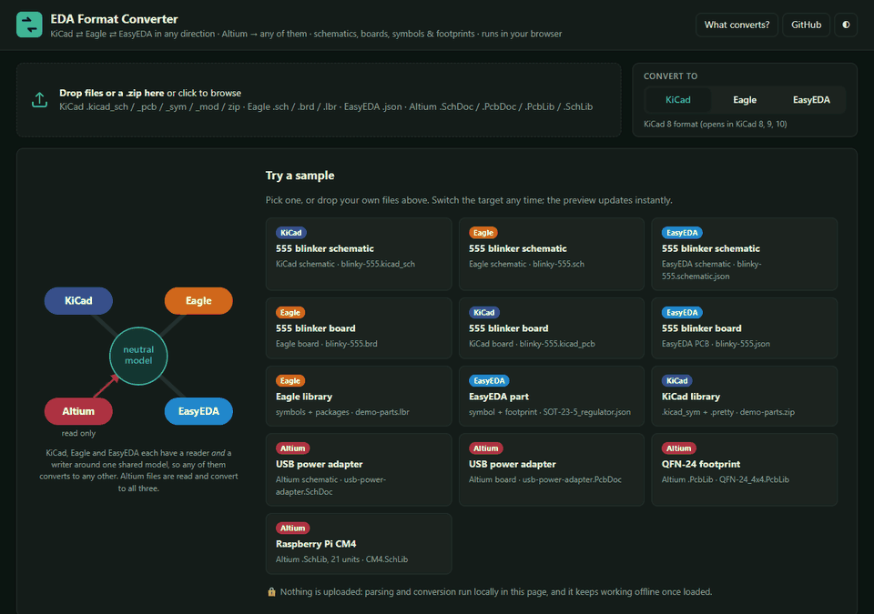

# EDA Format Converter

*KiCad ⇄ Eagle ⇄ EasyEDA, and from Altium, in the browser*


A converter for **schematics, PCB boards, symbols and footprints** between **KiCad**, **Eagle / Fusion Electronics** and **EasyEDA Standard** in any direction, and from **Altium Designer** into any of them. Drop a file in the [web app](https://abdulhamid-baghdadi.github.io/eda-format-converter/), choose a target format, and compare the source and the converted result side by side before you download it. Everything runs in your browser, so your designs are never uploaded. The same code also runs as a command-line tool.

<p align="center"></p>

**▶ Open it: [abdulhamid-baghdadi.github.io/eda-format-converter](https://abdulhamid-baghdadi.github.io/eda-format-converter/)**, then drop your files or try one of the samples.

**Features**
- **Any source, any target.** Each format has a reader *and* a writer built on one shared model, so KiCad, Eagle and EasyEDA can each be the source or the target (9 directions, including same-format conversions that clean up or upgrade a file).
- **Schematics**: placed symbols (rotated, mirrored, multi-unit), wires, junctions, net labels (local, global, hierarchical), power symbols, no-connects, buses and notes, over one or several sheets. Every conversion keeps the netlist, meaning which pins connect to which.
- **Whole boards**: footprints on both sides at any angle, tracks and arcs, vias (blind/buried where the format allows), nets, copper zones and keepouts, board outline, holes, silkscreen and text, inner layers.
- **Libraries**: symbols (pins with type, shape and visibility, multi-unit parts, body graphics) and footprints (SMD/THT/NPTH pads, slots, custom pads, silk/fab/courtyard/mask/paste), with the symbol-to-footprint pin mapping and 3D-model references.
- **Side-by-side preview** of the source and the result, where the result is drawn from the file that was actually written, read back in. Includes layer toggles, synchronised pan and zoom, and a unit selector for multi-unit symbols.
- **A report for every file** listing what was converted, what was approximated and what was skipped, with the reason for each.
- Drag-and-drop single files, several files, or a **.zip** (for example a `.pretty` folder together with its `.kicad_sym`). Download single files or everything as one zip.
- Works **offline** once loaded, has light and dark themes, and works on phones.

## Formats

| Format | Read | Write | Files |
| --- | :-: | :-: | --- |
| **KiCad 6 – 10** | ✅ | ✅ | `.kicad_sch` (a zip for multi-sheet designs), `.kicad_pcb`, `.kicad_mod` (or a zipped `.pretty`), `.kicad_sym` |
| **Eagle 6 – 9 / Fusion Electronics** | ✅ | ✅ | `.sch`, `.brd`, `.lbr` (XML) |
| **EasyEDA Standard** | ✅ | ✅ | schematic, PCB, footprint and symbol `.json` (*File › EasyEDA Source*), and the JSON of a part from EasyEDA's component API |
| **Altium Designer / CircuitMaker** | ✅ | — | `.SchDoc`, `.PcbDoc`, `.PcbLib`, `.SchLib` (binary) |

Altium is read only: it converts to KiCad, Eagle or EasyEDA. Writing Altium files isn't planned, because Altium imports KiCad and Eagle designs itself.

KiCad output uses the **KiCad 8 file format**, which KiCad 8, 9 and 10 all open. Eagle output is Eagle 9 XML. EasyEDA output opens with *File › Open › EasyEDA Source* in EasyEDA Standard.

EasyEDA Pro (`.epro`) files are not converted yet, and the app tells you so when you drop one. See [Roadmap](#roadmap).

## What converts

Each row says what the **target** format can hold. ✅ means exact, ⚠️ means approximated (and listed in the report), ❌ means dropped.

| | to KiCad | to Eagle | to EasyEDA Std |
| --- | --- | --- | --- |
| Footprints: SMD / THT / NPTH pads | ✅ | ✅ | ✅ |
| Pad shapes | ✅ all (trapezoid → rect) | ⚠️ THT pads: round, square, octagon, 2:1 long only | ⚠️ no rounded rect (→ rect) |
| Slotted holes | ✅ | ⚠️ round drill | ✅ |
| Silk / fab / courtyard / mask / paste graphics | ✅ | ✅ | ✅ (courtyard → Mechanical) |
| Arcs, circles, polygons | ✅ | ✅ | ✅ |
| 3D model reference | ✅ | ❌ | ⚠️ name only |
| Symbols: pins (type, shape, hidden), body graphics | ✅ | ✅ | ✅ |
| Multi-unit symbols | ✅ units | ✅ gates | ⚠️ one symbol per unit |
| Symbol ↔ footprint pin mapping | ✅ pad numbers | ✅ `connect`s | ✅ pad numbers |
| Boards: footprints on top and bottom, any angle | ✅ | ✅ | ✅ |
| Tracks, track arcs, vias | ✅ | ✅ | ✅ (through vias only) |
| Nets | ✅ | ✅ signals | ✅ |
| Copper zones, keepouts | ✅ (refill after opening) | ✅ polygons / restrict layers | ✅ copper areas / cutouts |
| Board outline, holes, text | ✅ | ✅ | ✅ |
| Copper layers | ✅ up to 32 | ✅ up to 16 | ✅ up to 34 |
| **Schematics:** symbols, wires, junctions, labels, no-connects | ✅ | ✅ (no-connects dropped) | ✅ |
| Power symbols | ✅ | ✅ supply symbols | ✅ net flags (PWR_FLAG dropped) |
| Multi-sheet / hierarchical designs | ✅ (sheets flattened, hierarchical → global labels) | ✅ sheets | ✅ one file per sheet |
| Buses | ✅ drawn; member nets keep their names | ⚠️ drawn only | ✅ drawn |
| Pin numbers on schematic symbols | ✅ | ⚠️ kept on a placeholder package named after the footprint | ✅ |
| Design rules, net classes, dimensions, images | ❌ | ❌ | ❌ |

### From Altium

The Altium reader takes in:

- **Boards (`.PcbDoc`):** components on both sides, pads (round, rectangular, rounded-rectangle, octagonal, slotted holes), tracks and arcs, vias, nets, polygon pours (as zones), copper regions and fills, polygon cutouts and keepouts, board cutouts, the board outline (with arcs), text, and the inner layers in stack order.
- **Footprint libraries (`.PcbLib`):** the same primitives per footprint. Vias inside a footprint, such as thermal vias in an exposed pad, become unnumbered pads.
- **Symbol libraries (`.SchLib`):** multi-part symbols, pins (type, direction, inverted/clock, hidden), body graphics, the designator prefix, parameters and the linked footprint name.

Some things are approximated or dropped, and each case is listed in the report:

- Mechanical layers go to `Dwgs.User`, because what each one means differs between projects.
- TrueType text is drawn with the target's stroke font.
- 3D bodies, design rules, dimensions, alternate (De Morgan) symbol views and pad-hole offsets are dropped.

### Schematics

Schematics convert between KiCad, Eagle and EasyEDA in any direction, and from Altium `.SchDoc`. What matters in a schematic is its connectivity, so every conversion is checked by comparing netlists (which pins connect to which) before and after. The same connectivity rules are used for every format: wire ends and T-joints, pins touching wires, local labels within a sheet, global and hierarchical labels and power symbols across sheets, and hidden power pins joining the net of their name, as KiCad and Eagle do.

- Hierarchical KiCad designs: drop all the `.kicad_sch` files together, or a zip of the project folder. Sheets are flattened, so hierarchical labels and sheet pins connect by name like global labels.
- Eagle stores pin numbers only on packages. A schematic written to Eagle therefore gets placeholder packages named after each part's footprint (one pad per pin number), and you can swap in the real packages in Eagle.
- Altium and EasyEDA store each placed symbol with its geometry already on the sheet, so each placement becomes its own symbol definition.

## Using it

**In the browser.** Open the [web app](https://abdulhamid-baghdadi.github.io/eda-format-converter/), drop your files, and pick *KiCad*, *Eagle* or *EasyEDA*. The source format is detected from the file contents, so the file extension doesn't matter. Check the preview and the report, then download.

- **KiCad:** a `.kicad_pcb` opens directly; press **B** to refill the zones. Libraries come as a `.kicad_sym` plus a `.pretty` folder. Add both in *Preferences › Manage Symbol/Footprint Libraries*. The symbols' *Footprint* fields already point to `<library>:<footprint>`.
- **Eagle / Fusion:** open the `.brd` or `.lbr`. Libraries contain one device set per symbol, with its package and pin-pad connections.
- **EasyEDA Standard:** *File › Open › EasyEDA Source* and pick the `.json`.

**On the command line** (Node 20+):

```bash
git clone https://github.com/Abdulhamid-Baghdadi/eda-format-converter && cd eda-format-converter
npm install && npm run cli
node dist/cli.mjs board.brd --to kicad --out converted --report
node dist/cli.mjs my-parts.lbr part.json footprints.zip --to easyeda --out converted
```

`--report` prints the same converted / approximated / skipped report the web app shows.

## How it works

```
 .kicad_*  ─┐                                ┌─► .kicad_*
 .brd/.lbr ─┼─► reader ─► neutral model ─► writer ─┼─► .brd/.lbr
 .json     ─┘     (per format)      (per format)   └─► .json
```

- **One model in the middle** ([`src/core/model.ts`](src/core/model.ts)): boards, footprints and symbols in millimetres. Footprints and boards use Y pointing down and symbols use Y pointing up. Layers use KiCad's names (`F.Cu`, `B.SilkS`, `In2.Cu`, `Edge.Cuts`…), the finest common vocabulary of the three formats. Arcs are stored as three points (start, mid, end), so they survive mirroring and rotation without sign mistakes.
- **A reader and a writer per format**, with no direct format-to-format code. Adding a format means writing one reader and one writer, and it then converts to and from all the others.
- **KiCad**: a small S-expression parser and writer ([`kicad/`](src/core/kicad)). It reads KiCad 6 to 10, including KiCad 5 `module`s with centre-angle arcs and KiCad 10 boards that store nets by name. It writes the KiCad 8 format.
- **Eagle**: XML through `fast-xml-parser` ([`eagle/`](src/core/eagle)). This covers wire `curve` arcs, the `MRθ` element transform (rotate, then mirror about Y, as KiCad's own importer does), auto pad and via diameters from the board's design rules, smashed name/value labels, and devices → symbols with gates and connects.
- **EasyEDA Standard**: the `~`-separated shape strings in 10-mil units ([`easyeda/`](src/core/easyeda)), including SVG path arcs, polygon pads, slots, `LIB` footprint instances on boards, and pin paths that give each pin's direction.
- **Altium** ([`altium/`](src/core/altium)): Altium's binary files are OLE compound files. A small reader written from Microsoft's published [MS-CFB] specification opens the container. Inside it, text records (`|KEY=VALUE|`) hold components, nets and the board outline, and little-endian binary records hold pads, tracks, arcs, vias, text, fills and regions, in units of 1/10000 mil. The record layouts were checked against real files and against the Apache-2.0 [AltiumSharp](https://github.com/issus/AltiumSharp) project's documentation of the format. No code from GPL importers was used.
- The **web app** ([`src/web/`](src/web)) is TypeScript and Vite with no UI framework. The previews are SVG drawn from the model. The *result* pane re-reads the written file, so what you see is what was written.

Schematics are checked against KiCad's own netlist: on KiCad's demo schematics, the netlist this project computes matches `kicad-cli sch export netlist`, before and after converting to every format.

The format readers and writers were written for this project from the published file formats and from inspecting real files. No code from GPL or AGPL projects (KiCad's importers, easyeda2kicad) was used, so the project can be MIT licensed.

## How it is tested

`npm test` runs 91 tests ([`tests/`](tests)):

- **Every sample through every format and back** (boards and libraries, 3 × 3), compared geometrically: each pad's world position, size and net, every track and via, and each pin's number, position and direction.
- **In the real KiCad** (when `kicad-cli` is installed): the demo board converted *from KiCad, Eagle and EasyEDA* must pass **KiCad's DRC with zero violations and zero unconnected items** after refilling zones. Converted symbol and footprint libraries must load and plot. **KiCad's own Eagle importer** must place every pad exactly where this project's Eagle reader does.
- **Schematics**: every sample schematic (KiCad, Eagle, EasyEDA, Altium) converts to all three formats without changing a single connection. The 555 schematic has exactly the nets of the 555 board. The Altium schematic matches its Altium board. With KiCad installed, **KiCad's netlist of each converted `.kicad_sch` equals ours**, and the KiCad and Eagle versions pass **KiCad's ERC with no errors**.
- **Altium**: the sample board, footprint and symbol library are read and converted to all three formats without moving any copper or pin, and (with KiCad installed) **KiCad's own Altium importer places every pad, track and via exactly where this reader does**.
- Geometry unit tests: arc conventions of each format, the Eagle rotate/mirror order, and S-expression edge cases.

Wider checks, run locally against files that can't be redistributed:

| Check | Result |
| --- | --- |
| 3,584 symbols and footprints from KiCad's own libraries (QFP, QFN, BGA, TO, USB, headers, MCUs, op-amps, 74xx…) → each format → back | KiCad → KiCad 3583/3584 exact, KiCad → EasyEDA 3584/3584 exact. Eagle: all pads in place; 1,749 footprints have oval or rectangular through-hole pads that Eagle can't represent exactly (reported). |
| KiCad demo boards (`video` 2,118 pads / 7,932 tracks / 808 vias, `StickHub` with parts at 45° on the bottom, `kit-dev-coldfire`) → Eagle → KiCad's Eagle importer | 0 pad, track or via differences from this project's Eagle reader |
| The same boards → EasyEDA → back, and → KiCad → back | 0 differences |
| A real Eagle 7.7 board (a controller board from a student project) → KiCad, compared with KiCad's own import of the same `.brd` | 119/119 pads identical in position, size and net |
| 182 symbols and packages from real Eagle libraries → all three formats → back | 182/182 exact |
| KiCad's demo schematics `ecc83`, `interf_u` (110 nets) and `sonde xilinx` → this reader, and → KiCad, Eagle and EasyEDA → back | Identical to KiCad's own netlist, before and after every conversion |
| Hierarchical KiCad demos with buses (`pic_programmer`, `kit-dev-coldfire`) | `pic_programmer`: 33 of 34 nets identical (one pin differs). Bus-heavy hierarchies are approximate, see Limitations. |
| 8 Altium schematics (AltiumSharp test data) compared with the nets of their own Altium boards | 75/75 schematic nets sit on exactly one board net |
| 4 real Altium boards (MAX5719 breakout, VCOCXO breakout, SPI isolator, USB power adapter; 2 and 4 layers): this reader compared with KiCad's own Altium importer | 517/517 pads identical (position, size, net), 1,162 tracks and 1,898 vias identical. Two panel files, which only place copies of other boards, are reported as not converted. |
| 11 Altium footprints (BGA-900, BGA-676, UFBGA, WLCSP, LFCSP, QFN…) compared with AltiumSharp's JSON dumps of the same files | 2,118/2,118 pads identical in name, position and size |
| 21 Altium footprints and symbols (incl. the 21-unit Raspberry Pi CM4 symbol) → KiCad and EasyEDA → back | 21/21 exact; the KiCad symbols load and plot in KiCad 10 |
| 4 parts from EasyEDA's library (STM32F103, RP2040, a USB-C socket, a 0603 resistor: 8 symbols and footprints) → each format → back, and opened in KiCad 10 | 8/8 exact through KiCad and EasyEDA; all load and plot in KiCad |

## Samples

The app's first samples are **whole projects**: a zip with the schematic and the board, in KiCad, Eagle, EasyEDA and Altium form. Both convert together and show as *Schematic* and *Board layout* tabs. You can drop your own project zip, or several files at once, the same way.

[`public/samples/`](public/samples) has small, freely licensed files to try. The app has a button for each one:

- **`blinky-555`** is a 555 LED blinker: a **schematic** (`.kicad_sch`, Eagle `.sch`, EasyEDA `.schematic.json`) and its 2-layer board (39 × 20 mm, SOIC-8, 0805 parts, a pin header, one part on the bottom at 45°, a GND pour on the bottom layer, and rounded corners), in KiCad, Eagle and EasyEDA versions. It was built for this project from footprints in the official KiCad library ([`scripts/make-samples.ts`](scripts/make-samples.ts)).
- **`demo-parts.lbr`** is a hand-written Eagle library: a resistor, a dual op-amp with three gates, an LDO, an NPN transistor, a header, and a GND supply symbol.
- **`SOT-23-5_regulator.json`** is a hand-made EasyEDA Standard part (symbol and footprint), laid out like EasyEDA's own JSON.
- **Altium:** **`usb-power-adapter.SchDoc`** and **`usb-power-adapter.PcbDoc`** (a schematic and its 2-layer board) and **`QFN-24_4x4.PcbLib`** (a QFN-24 footprint) come from the [AltiumSharp](https://github.com/issus/AltiumSharp) test data (Apache-2.0). **`CM4.SchLib`** (the 21-unit Raspberry Pi CM4 symbol) comes from QWaveSystems' [CM4 Altium library](https://github.com/QWaveSystems/QWAVE_Raspberry-Pi-CM4-Altium-Library) (MIT). See [`public/samples/THIRD_PARTY.md`](public/samples/THIRD_PARTY.md).
- **`demo-parts.zip`** is a hand-written KiCad library (`.kicad_sym` + `.pretty`) with a multi-unit op-amp, an LED, a SOIC-8, and a terminal block with a slot.

## Limitations

- **Schematics:** hierarchy is flattened. Bus member nets that cross hierarchical sheets are matched by name, which fits most designs, but large bus-heavy hierarchies can differ from KiCad by a few pins. Eagle has no no-connect marker, and EasyEDA has no PWR_FLAG. Altium sheet symbols are not expanded, so convert each `.SchDoc`.
- **EasyEDA Pro** files are not converted yet.
- **Altium is input only**, and only binary files are read (not the ASCII `.PcbDoc` variant). Altium's newer "shape-based" regions duplicate the normal ones and are ignored. Panels made of embedded boards are not expanded, so open the board itself.
- **Zones are written unfilled.** Refill them in the target tool (KiCad: **B**). Thermal relief settings, net classes and design rules are not carried over.
- **Eagle through-hole pads** can only be round, square, octagonal, or "long" with a fixed 2:1 ratio. Other ovals and rectangles become the nearest Eagle shape, and slots become round drills (all listed in the report).
- **EasyEDA Standard** has no rounded-rectangle pads (they become rectangles) and stores one symbol per unit. 3D models stay on EasyEDA's server, so only the model's name is carried over. You can get the STEP with the [KiCad JLCPCB part picker](https://github.com/Abdulhamid-Baghdadi/kicad-jlcpcb-part-picker).
- **Text** uses each tool's own stroke font, so text widths differ slightly. Where formats anchor text differently, the position is converted with an estimated text width.
- Dimensions, images, groups and variants are dropped.

## Roadmap

- Full bus semantics for hierarchical schematics, and keeping hierarchy (rather than flattening it) when writing KiCad.
- EasyEDA Pro (`.epro` / `.elibz`), PADS ASCII (read and write), and IPC-2581 (the open manufacturing exchange standard).
- Exporting design rules and net classes where formats share them.

## Development

```bash
npm install
npm run dev        # web app on http://localhost:5173
npm test           # unit and round-trip tests (+ kicad-cli checks if KiCad is installed)
npm run build      # static site in site/ (deployed to GitHub Pages by .github/workflows/pages.yml)
npm run samples    # rebuild the demo board from KiCad's footprint library
```

## Licence

[MIT](LICENSE). The demo board uses footprints from the [KiCad library](https://gitlab.com/kicad/libraries/kicad-footprints) (CC-BY-SA 4.0 with an exception that allows designs made with them to be distributed freely). KiCad, Eagle, Fusion and EasyEDA are trademarks of their owners, and this project is not affiliated with any of them.
